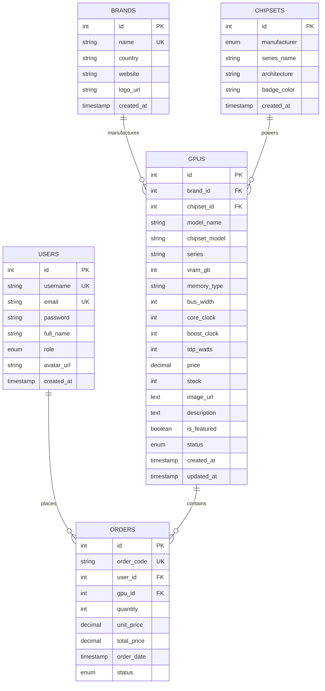

# ⚡ CYBER-GPU STORE — Next-Gen Gaming & AI Compute Hardware
> **Full-Stack Web Application (PHP, MySQL, Tailwind CSS, JavaScript, SweetAlert2, Chart.js)**  
> สถาปัตยกรรมเว็บไซต์ E-Commerce & Inventory Management สำหรับการ์ดจอเกมมิ่งและฮาร์ดแวร์ประมวลผล AI ธีม **Cyber-Tech & Futuristic Glassmorphism**

---

## 📁 1. โครงสร้างไฟล์ของโปรเจกต์ (Folder Structure)

```text
Webpage-main/
├── config/
│   └── db.php                  # ไฟล์เชื่อมต่อฐานข้อมูลส่วนกลางด้วย PDO (utf8mb4) & Helper Functions
├── database/
│   └── database.sql            # สคริปต์สร้าง Schema ฐานข้อมูลและ Mock Data การ์ดจอ 12 รุ่น
├── includes/
│   ├── header.php              # Global Header (Tailwind CDN, Google Fonts, SweetAlert2, Chart.js)
│   ├── navbar.php              # Futuristic Sticky Navbar พร้อมสถานะผู้ใช้และเมนู Responsive
│   └── footer.php              # Global Footer, System Status และ Quick View Modal Container
├── assets/
│   ├── css/
│   │   └── cyber-style.css     # Glassmorphism, Dynamic Neon Glow (NVIDIA, AMD, Intel), Print CSS
│   └── js/
│       └── main.js             # Real-time Image Preview, SweetAlert2 Delete Confirm, Modals
├── index.php                   # หน้าหลัก Hero Banner + Grid Card + Badge แยกค่าย + สเปคย่อ
├── search.php                  # หน้าค้นหา & ตัวกรองสเปค (ค่ายชิปเซ็ต, แบรนด์, VRAM, เรียงราคา)
├── add_gpu.php                 # หน้าฟอร์มเพิ่มการ์ดจอใหม่ + Live Image Preview ก่อนบันทึก
├── edit_gpu.php                # หน้าแก้ไขข้อมูลการ์ดจอ (Prepared Statements) + Live Image Preview
├── delete_gpu.php              # สคริปต์ประมวลผลการลบข้อมูล (ปลอดภัย ป้องกัน SQL Injection)
├── manage.php                  # หน้าแดชบอร์ดจัดการคลังสินค้า + ตาราง CRUD + ปุ่มลบ SweetAlert2
├── reports.php                 # หน้ารายงานสรุปคลังสินค้า 2 รายงาน + Chart.js + window.print()
├── login.php                   # หน้าเข้าสู่ระบบ (Session + password_verify() + ปุ่มทดสอบด่วน)
├── register.php                # หน้าสมัครสมาชิกใหม่ (password_hash(BCRYPT) + JS Validation)
├── logout.php                  # สคริปต์ออกจากระบบและเคลียร์ Session
└── README.md                   # คู่มือระบบ, ER Diagram, Schema Mapping, Data Dictionary
```

---

## 🗄️ 2. การออกแบบฐานข้อมูล (Database Design)

### 2.1 ER Diagram (Entity-Relationship Diagram)



### 2.2 คำอธิบายความสัมพันธ์ (Relationship Descriptions)
1. **BRANDS to GPUS (One-to-Many: 1:N):**  
   แบรนด์ผู้ผลิตหนึ่งแบรนด์ (เช่น ASUS, MSI, GIGABYTE) สามารถผลิตการ์ดจอได้หลายรุ่น แต่การ์ดจอแต่ละรุ่นจะสังกัดแบรนด์ผู้ผลิตได้เพียงแบรนด์เดียว โดยใช้ `brand_id` ในตาราง `gpus` เป็น Foreign Key ชี้ไปยัง `brands.id` (พร้อมเงื่อนไข `ON DELETE CASCADE`)
2. **CHIPSETS to GPUS (One-to-Many: 1:N):**  
   ค่ายชิปเซ็ตประมวลผลหนึ่งค่าย (เช่น NVIDIA, AMD, Intel) จะเป็นขุมพลังให้กับการ์ดจอได้หลายรุ่น โดยใช้ `chipset_id` ในตาราง `gpus` เป็น Foreign Key ชี้ไปยัง `chipsets.id`
3. **USERS to ORDERS (One-to-Many: 1:N):**  
   ผู้ใช้งานหรือลูกค้าหนึ่งคนสามารถสร้างคำสั่งซื้อได้หลายคำสั่งซื้อ โดยใช้ `user_id` ในตาราง `orders` ชี้ไปยัง `users.id`
4. **GPUS to ORDERS (One-to-Many: 1:N):**  
   การ์ดจอหนึ่งรุ่นสามารถปรากฏในรายการสั่งซื้อได้หลายครั้ง โดยใช้ `gpu_id` ในตาราง `orders` ชี้ไปยัง `gpus.id`

---

### 2.3 Relational Schema Mapping
- **`users`** (<ins>`id`</ins>, `username`, `email`, `password`, `full_name`, `role`, `avatar_url`, `created_at`)
- **`brands`** (<ins>`id`</ins>, `name`, `country`, `website`, `logo_url`, `created_at`)
- **`chipsets`** (<ins>`id`</ins>, `manufacturer`, `series_name`, `architecture`, `badge_color`, `created_at`)
- **`gpus`** (<ins>`id`</ins>, <mark>`brand_id`</mark>, <mark>`chipset_id`</mark>, `model_name`, `chipset_model`, `series`, `vram_gb`, `memory_type`, `bus_width`, `core_clock`, `boost_clock`, `tdp_watts`, `price`, `stock`, `image_url`, `description`, `is_featured`, `status`, `created_at`, `updated_at`)
  - **PK:** `id`
  - **FK1:** `brand_id` REFERENCES `brands(id)`
  - **FK2:** `chipset_id` REFERENCES `chipsets(id)`
- **`orders`** (<ins>`id`</ins>, `order_code`, <mark>`user_id`</mark>, <mark>`gpu_id`</mark>, `quantity`, `unit_price`, `total_price`, `order_date`, `status`)
  - **PK:** `id`
  - **FK1:** `user_id` REFERENCES `users(id)`
  - **FK2:** `gpu_id` REFERENCES `gpus(id)`

---

### 2.4 พจนานุกรมข้อมูล (Data Dictionary)

#### ตาราง: `gpus` (ข้อมูลการ์ดจอ)
| Column Name | Data Type | Nullable | Key | Default | Description |
| :--- | :--- | :---: | :---: | :--- | :--- |
| `id` | INT UNSIGNED | NO | PK | AUTO_INCREMENT | รหัสอ้างอิงการ์ดจอ |
| `brand_id` | INT UNSIGNED | NO | FK | - | รหัสแบรนด์ผู้ผลิต (เชื่อมโยง brands.id) |
| `chipset_id` | INT UNSIGNED | NO | FK | - | รหัสค่ายชิปเซ็ต (เชื่อมโยง chipsets.id) |
| `model_name` | VARCHAR(180) | NO | - | - | ชื่อรุ่นเต็มของการ์ดจอ |
| `chipset_model`| VARCHAR(80) | NO | - | - | รหัสชิปเซ็ต เช่น RTX 4090, RX 7900 XTX |
| `series` | VARCHAR(60) | NO | - | - | ซีรีส์ เช่น RTX 40 Series, RX 7000 |
| `vram_gb` | INT | NO | - | - | ขนาดแรมการ์ดจอ (GB) |
| `memory_type` | VARCHAR(30) | NO | - | 'GDDR6X' | ชนิดของแรม (GDDR6, GDDR6X, GDDR7) |
| `bus_width` | INT | NO | - | - | ความกว้างบัสข้อมูล (Bit) |
| `core_clock` | INT | NO | - | - | ความเร็วประมวลผลพื้นฐาน (MHz) |
| `boost_clock` | INT | NO | - | - | ความเร็วประมวลผลสูงสุด (MHz) |
| `tdp_watts` | INT | NO | - | - | อัตรากินพลังงานความร้อน (Watts) |
| `price` | DECIMAL(10,2) | NO | - | - | ราคาจำหน่าย (บาท) |
| `stock` | INT | NO | - | 0 | จำนวนสินค้าคงเหลือในคลัง |
| `image_url` | TEXT | NO | - | - | URL รูปภาพการ์ดจอ |
| `description` | TEXT | YES | - | NULL | รายละเอียดและฟีเจอร์เด่น |
| `is_featured` | TINYINT(1) | NO | - | 0 | สถานะปักหมุดสินค้าแนะนำ (1 = ใช่, 0 = ไม่) |
| `status` | ENUM | NO | - | 'available' | available, low_stock, out_of_stock |
| `created_at` | TIMESTAMP | NO | - | CURRENT_TIMESTAMP | วันที่บันทึกข้อมูล |
| `updated_at` | TIMESTAMP | NO | - | CURRENT_TIMESTAMP | วันที่อัปเดตล่าสุด |

#### ตาราง: `brands` (แบรนด์ผู้ผลิต / AIB Partners)
| Column Name | Data Type | Nullable | Key | Default | Description |
| :--- | :--- | :---: | :---: | :--- | :--- |
| `id` | INT UNSIGNED | NO | PK | AUTO_INCREMENT | รหัสแบรนด์ |
| `name` | VARCHAR(60) | NO | UK | - | ชื่อแบรนด์ (ASUS ROG, MSI, GIGABYTE) |
| `country` | VARCHAR(60) | NO | - | - | ประเทศต้นกำเนิด |
| `website` | VARCHAR(255) | YES | - | NULL | เว็บไซต์ทางการ |
| `logo_url` | VARCHAR(255) | YES | - | NULL | URL โลโก้แบรนด์ |

#### ตาราง: `chipsets` (ค่ายชิปเซ็ตประมวลผล)
| Column Name | Data Type | Nullable | Key | Default | Description |
| :--- | :--- | :---: | :---: | :--- | :--- |
| `id` | INT UNSIGNED | NO | PK | AUTO_INCREMENT | รหัสชิปเซ็ต |
| `manufacturer` | ENUM | NO | - | - | NVIDIA, AMD, Intel |
| `series_name` | VARCHAR(60) | NO | - | - | ชื่อรุ่นซีรีส์ เช่น GeForce RTX 40 Series |
| `architecture` | VARCHAR(60) | NO | - | - | สถาปัตยกรรม เช่น Ada Lovelace, RDNA 3 |
| `badge_color` | VARCHAR(20) | NO | - | '#00FF66' | รหัสสีประจำค่าย (#00FF66, #FF0055, #00F0FF) |

#### ตาราง: `users` (ผู้ใช้งานระบบ)
| Column Name | Data Type | Nullable | Key | Default | Description |
| :--- | :--- | :---: | :---: | :--- | :--- |
| `id` | INT UNSIGNED | NO | PK | AUTO_INCREMENT | รหัสผู้ใช้งาน |
| `username` | VARCHAR(50) | NO | UK | - | ชื่อบัญชีผู้ใช้ |
| `email` | VARCHAR(100) | NO | UK | - | อีเมลสำหรับติดต่อ |
| `password` | VARCHAR(255) | NO | - | - | รหัสผ่านเข้ารหัสด้วย BCRYPT hash |
| `full_name` | VARCHAR(100) | NO | - | - | ชื่อ - นามสกุล |
| `role` | ENUM | NO | - | 'member' | สิทธิ์ผู้ใช้ ('admin', 'member') |
| `avatar_url` | VARCHAR(255) | YES | - | Default URL | ลิงก์รูปโปรไฟล์ |

---

## 🚀 3. วิธีการติดตั้งและทดสอบระบบ (Setup Guide)

### 3.1 ขั้นตอนการตั้งค่า MySQL
1. เปิดโปรแกรม **XAMPP / Laragon** แล้ว Start บริการ **Apache** และ **MySQL**
2. เข้าสู่ **phpMyAdmin** (`http://localhost/phpmyadmin`)
3. สร้างฐานข้อมูลใหม่ชื่อ: `gpu_store` (Collation: `utf8mb4_unicode_ci`)
4. กดที่แท็บ **Import** แล้วเลือกไฟล์ `database/database.sql` จากโปรเจกต์นี้ จากนั้นกด **Go**

### 3.2 การรันเว็บแอปพลิเคชัน
1. วางโฟลเดอร์โปรเจกต์ไว้ที่ `htdocs/` (เช่น `C:/xampp/htdocs/gpu-store`)
2. เปิดเว็บบราวเซอร์ไปที่: `http://localhost/gpu-store/index.php`

### 3.3 บัญชีผู้ใช้สำหรับการทดสอบ (Demo Accounts)
ในหน้า `login.php` มีปุ่มกดเติมข้อมูลอัตโนมัติ 1-Click หรือใช้ข้อมูลดังนี้:
- **ผู้ดูแลระบบ (Admin Operator):**
  - Username: `admin`
  - Password: `admin123`
- **สมาชิกทั่วไป (Member):**
  - Username: `gamer_pro`
  - Password: `user123`

---

## 🌟 4. ฟีเจอร์เด่นตามเกณฑ์โครงงาน (Key Implemented Features)

1. **สไตล์ดีไซน์ Cyber-Tech & Futuristic:**
   - Dark Mode อวกาศไซเบอร์โทนสี `#060911` และ `#0A0F1D`
   - แผ่นกระจกฝ้า **Glassmorphism** (`backdrop-filter: blur(14px)`)
   - ไฟนีออนเรืองแสงแยกตามค่ายชิปเซ็ต:
     - 🟢 **NVIDIA:** `#00FF66` (Cyber Green)
     - 🔴 **AMD:** `#FF0055` (Neon Crimson)
     - 🔵 **Intel:** `#00F0FF` (Arc Cyan)
   - ฟอนต์ Sci-Fi: `'Orbitron'`, `'Rajdhani'` คู่กับฟอนต์ภาษาไทย `'Prompt'`
2. **ระบบค้นหาและกรองสเปคขั้นสูง (`search.php`):**
   - ค้นหาคำสำคัญ (ชื่อรุ่น, ซีรีส์)
   - กรองตามแบรนด์ AIB (ASUS, MSI, GIGABYTE, ZOTAC, Sapphire, PowerColor, Intel)
   - กรองตามค่ายชิปเซ็ต (NVIDIA, AMD, Intel)
   - กรองตามขนาด VRAM (8GB, 12GB, 16GB, 24GB)
   - เรียงลำดับราคา (ต่ำไปสูง, สูงไปต่ำ) และจำนวนคงคลัง
3. **ระบบเพิ่ม/แก้ไข พร้อม Live Image Preview (`add_gpu.php`, `edit_gpu.php`):**
   - แสดงตัวอย่างรูปภาพแบบเรียลไทม์ทันทีที่พิมพ์หรือเลือก Presets ก่อนกดบันทึก
4. **ระบบลบข้อมูลผ่าน SweetAlert2 (`manage.php`, `delete_gpu.php`):**
   - หน้าต่างโมดัลแบบนีออนไซเบอร์ถามยืนยันก่อนลบ ป้องกันการกดลบโดยไม่ตั้งใจ
5. **ระบบรายงาน 2 ฉบับระดับผู้บริหาร (`reports.php`):**
   - **รายงานที่ 1:** สรุปมูลค่าและปริมาณคลังสินค้าแยกตามค่ายและแบรนด์ ใช้ฟังก์ชัน SQL `GROUP BY`, `COUNT`, `SUM`, `AVG` พร้อมแผนภูมิวงแหวน **Chart.js**
   - **รายงานที่ 2:** ตรวจสอบสินค้าสต็อกวิกฤต (Low Stock Alert: เหลือน้อยกว่า 3 ชิ้น) และอันดับการ์ดจอมูลค่าสูงสุด พร้อมปุ่มสั่งพิมพ์รายงาน (`window.print()`) ที่มี CSS จัดหน้ากระดาษพิมพ์แบบขาว-ดำทางการ